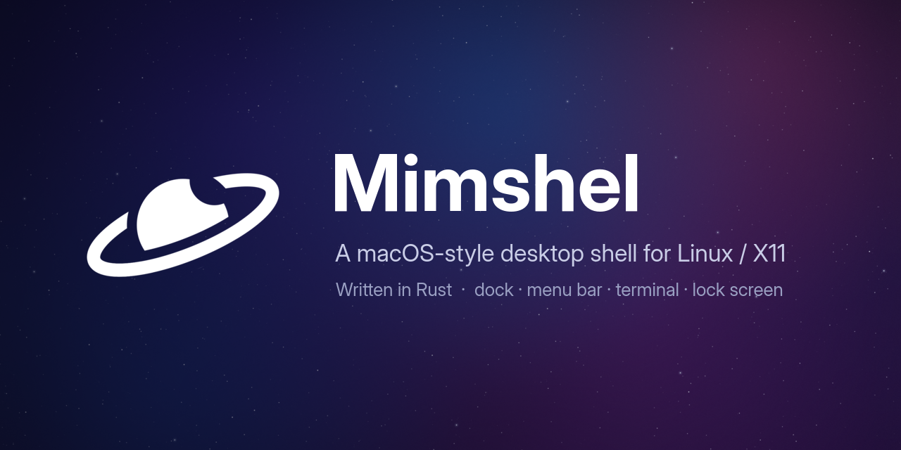
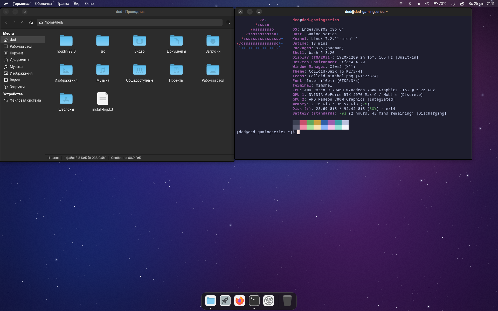

<p align="center">
  
</p>

<p align="center">
  <a href="https://github.com/ded-achtung/Mimshel/actions/workflows/check.yml"></a>
  
  
</p>

**English** · [Русский](README.ru.md)

**Mimshel** is a macOS-style desktop shell for Linux on X11, written in Rust as a
single program with a single config file. It draws the menu bar, the dock, the
desktop, the file manager, the Search and Apps windows, notifications, the
Control Center, the lock screen and its own terminal. Windows are managed by
xfwm4 from Xfce. Wayland is not supported.

The name comes from Saturn's moon Mimas, its Herschel crater, and the word *shell*.

<p align="center">
  
</p>

## Why

The same look can be glued together from existing programs (the Xfce panel,
Plank, rofi, i3lock…), but every seam shows: slow launchers, ~450 MB of memory,
and bugs where the programs meet. Mimshel does it in one Rust program: the Search
window opens in a fraction of a second (0.1–0.2 s), and the whole shell — menu bar, dock, desktop,
notifications and file manager — takes around 30 MB of memory and practically no
CPU when idle.

## Features

- **Menu bar** — the app menu of the active window (GTK and DBusMenu, like on a
  Mac), the system tray (StatusNotifierItem), keyboard layout, clock with a
  calendar, battery, volume and a notification bell.
- **Control Center** — Wi-Fi, Bluetooth, Do Not Disturb and volume. Click a tile
  name for details:
  - **Wi-Fi**: nearby networks with signal strength, connect with one click;
  - **Bluetooth**: paired and nearby devices, pair and connect;
  - **Sound**: overall volume and a slider for **every app that is playing**.
- **Dock** — pin and reorder apps, window previews, Trash, magnification,
  auto-hide; the right-click menu can make an app always start on the
  **discrete NVIDIA GPU** (apps that ask for it, like Blender, do so automatically).
- **Search** (Super+Space) and **Apps** (Super+A) windows — they find apps even
  when typed in the wrong keyboard layout.
- **Desktop** — wallpapers drawn by the program, file icons, drag and drop to and
  from the file manager, keyboard shortcuts like in Finder and Windows Explorer.
- **File manager** — opens in about 0.1 s: places and devices, path bar, search,
  hidden files, copy/cut/paste, drag and drop.
- **Terminal** (`mimshel terminal`) — tabs, an app menu in the menu bar, colour
  emoji, mouse support for programs like htop and mc, OSC 52 clipboard (copy from
  programs over SSH), clickable links, a scrollbar for touchpads.
- **Notifications** — banners, history, Do Not Disturb.
- **Lock screen** — passwords checked by PAM, a watchdog restarts it after any
  failure, Super+L.
- **Setup** — `install.sh` sets everything up; `mimshel doctor` checks the
  system, `mimshel set` changes settings, `mimshel restore` brings back plain Xfce.

## Status

Alpha. It is used daily on a real laptop (EndeavourOS, Xfce, X11), but expect
rough edges. Wayland is not planned: the target programs (Houdini and others) run
on X11.

## Installing

You need EndeavourOS or Arch Linux with the Xfce desktop in an X11 session. In a
terminal:

```sh
git clone https://github.com/ded-achtung/Mimshel.git
cd Mimshel && ./install.sh
```

The installer asks for your sudo password. It installs the packages, the Colloid
icons, window theme and cursor, builds Mimshel into `~/.local/bin/mimshel` and
turns all of its parts on. It saves a copy of your settings first —
`~/.local/bin/mimshel restore` brings them back. Log out and back in afterwards.
Running it again is safe.

## Using

```sh
mimshel search            # open the Search window (also Super+Space)
mimshel apps              # open the Apps window (also Super+A)
mimshel terminal          # a new terminal window
mimshel folder ~/Pictures # open a folder
mimshel doctor            # check the setup
mimshel config            # list the settings
mimshel set dock.icon_size 56
mimshel --help            # all commands
```

Settings live in `~/.config/mimshel/config.toml` (TOML, with comments). The file
is checked for syntax, key names, types and value ranges; a broken file never
replaces the last good copy (`~/.local/state/mimshel/config.good.toml`), and the
service falls back to that copy.

## Building and testing

Tested with Rust 1.99.1. Rendering tests need system fonts (for example the
`fonts-dejavu-core` package); unit tests do not need an X server.

```sh
cargo build --release --locked
cargo fmt --all -- --check
cargo clippy --workspace --all-targets --locked -- -D warnings
cargo test --workspace --locked
# Windows on a virtual X server (needs Xvfb)
cargo test -p mimshel-x11 --test windows --locked -- --ignored
```

The same checks run in GitHub Actions. The X11 test starts its own Xvfb
(`MIMSHEL_TEST_XVFB` sets its path) and checks windows, pixels and the panel's
reserved space, with and without MIT-SHM. The D-Bus test checks notifications
on a private bus. The terminal tests run a real shell.

## How it is built

| Layer | Crates |
|---|---|
| Model and settings (no windows, no I/O) | `core` |
| Platform | `x11` (x11rb), `render` (tiny-skia, CPU), `text` (cosmic-text), `icons` (resvg), `apps` (Desktop Entry), `dbus` (zbus) |
| Shell parts | `launcher`, `dock`, `menubar`, `notify`, `desktop`, `folder`, `terminal`, `lock`, `wallpaper`, `widgets` |
| Setup and diagnostics | `setup` |
| The program | `apps/mimshel` — one long-running service plus separate processes for the terminal and the lock screen |

Everything is drawn on the CPU with tiny-skia, so it works without a GPU. The
terminal's escape-sequence parsing comes from `alacritty_terminal`
(Apache-2.0); its window, rendering, tabs and input are Mimshel's own.

## Approach

We study how macOS and existing programs behave and follow the open standards
(EWMH/ICCCM, Desktop Entry, Icon Theme, StatusNotifierItem, DBusMenu,
Notifications, BlueZ, NetworkManager), and write our own implementation. We do
not copy other projects' code. Passwords are checked by PAM, the same system used
at login.

## License

GPL-3.0-or-later — see [LICENSE](LICENSE).
